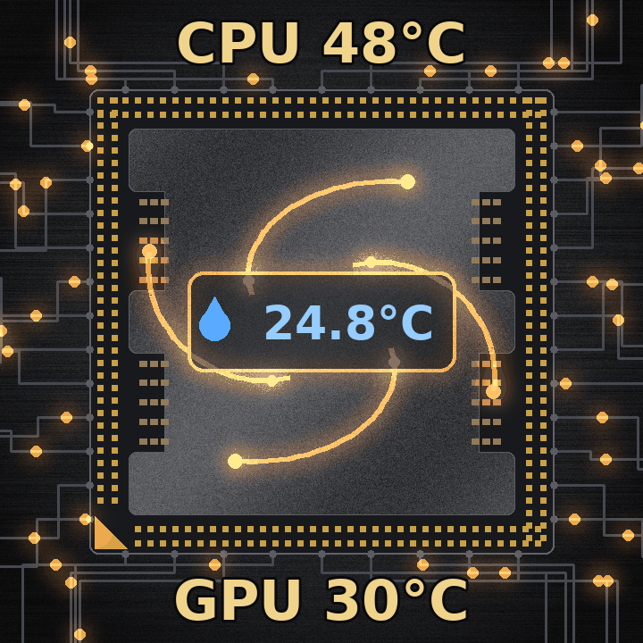

# InfoPanel.iCUE

Plugin für [InfoPanel](https://github.com/habibrehmansg/infopanel), das Sensorwerte aus **Corsair iCUE** anzeigt – zum Beispiel die **Wassertemperatur** einer Custom-Wasserkühlung mit iCUE LINK.



## Warum?

Die Wassertemperatur vom iCUE LINK System Hub taucht in LibreHardwareMonitor nicht auf, und HWiNFO verträgt sich beim Zugriff auf die Corsair-Sensoren nicht mit iCUE. Dieses Plugin fasst **keine Hardware an**: Es liest die **Sensorprotokollierung** von iCUE (CSV-Datei) und gibt die Werte an InfoPanel weiter. Kein Konflikt mit iCUE.

## Installation

1. InfoPanel beenden (auch im Tray).
2. `release/InfoPanel.iCUE.zip` **ungeöffnet** nach `C:\ProgramData\InfoPanel\plugins` kopieren.
   (Der Ordner ist versteckt – einfach den Pfad in die Adresszeile des Explorers eintippen.)
3. InfoPanel starten. Die ZIP wird automatisch entpackt.
4. Unter **Plugins** das Plugin **„iCUE Sensoren"** einschalten.

Update: InfoPanel beenden, den Ordner `InfoPanel.iCUE` im Plugin-Ordner löschen, neue ZIP hineinlegen, InfoPanel starten.

## iCUE einrichten

In iCUE: **Einstellungen → Sensorprotokollierung**

- Speicherort: Standard (`Dokumente`) lassen
- Intervall: z. B. 60 Sekunden (die Wassertemperatur ändert sich langsam)
- Gruppe auswählen (z. B. **iCUE LINK System Hub**) und die gewünschten Sensoren anhaken
- **Protokoll starten**

> **Wichtig:** iCUE merkt sich die laufende Protokollierung nicht über einen Neustart hinweg. Nach jedem Windows-Start einmal auf **„Protokoll starten"** drücken.

## In InfoPanel verwenden

Im **Design** unter **Plugins → iCUE Sensoren → iCUE** erscheinen:

| Eintrag | Inhalt |
|---|---|
| *Sensorname* (z. B. „Behälter") | Zahlenwert als Sensor (mit Min/Max/Durchschnitt) |
| *Sensorname* **(Anzeige)** | Fertiger Text, z. B. `24.8°C` – zeigt **`--`**, wenn die Protokollierung nicht läuft |
| Protokolldatei | Name der gelesenen CSV-Datei |
| Letzter Wert von | Zeitstempel des letzten Eintrags |

Die Namen kommen direkt aus iCUE. Wer in iCUE einen Sensor umbenennt, sieht den neuen Namen nach einem Neustart von InfoPanel.

## Einstellungen

Datei `InfoPanel.iCUE.ini` im Plugin-Ordner:

```ini
; Ordner, in den iCUE die Sensorprotokolle schreibt (leer = Dokumente)
Ordner=
; Nach so vielen Sekunden ohne neuen Eintrag zeigt die Anzeige "--"
MaxAlterSek=180
; Nachkommastellen in der Anzeige (0, 1 oder 2)
Nachkommastellen=1
```

Bei einem Protokoll-Intervall von 60 Sekunden sollte `MaxAlterSek` mindestens 180 sein.

## Beispiel-Layout (Barrowch FBLTHDA-04N V2, 1440 × 1440)

Hintergrund: [`beispiel/hintergrund.gif`](beispiel/hintergrund.gif) (animiert, 720 × 720, in InfoPanel auf 1440 × 1440 gezogen)

| Element | Schrift | Farbe | Größe | Position X / Y |
|---|---|---|---|---|
| Bild `hintergrund.gif` | – | – | 1440 × 1440 | 5 / 10 |
| Text „CPU" | Arial Fett | Goldenrod | 160 | 205 / 0 |
| CPU-Temperatur (Libre: Core Tctl/Tdie) | Arial Fett | Goldenrod | 160 | 720 / 0 |
| Text „GPU" | Arial Fett | Goldenrod | 160 | 205 / 1220 |
| GPU-Temperatur (Libre: GPU Core) | Arial Fett | Goldenrod | 160 | 720 / 1220 |
| Wasser (iCUE: Behälter (Anzeige)) | Arial Fett | Light Sky Blue | 155 | 540 / 625 |

Profil: Hintergrund schwarz, Schrift weiß, Position auf dem zweiten Bildschirm (X 2560, Y 0).

Tipp: Das Display am HDMI-Anschluss des Mainboards (integrierte Grafik, im BIOS auf „Forces") statt an der Grafikkarte betreiben.

## Selbst bauen

Voraussetzungen: .NET 8 SDK und der Quellcode von InfoPanel.

```
git clone https://github.com/habibrehmansg/infopanel
cd InfoPanel.iCUE/src
dotnet build -c Release -p:InfoPanelSrc=..\..\infopanel
```

Getestet mit InfoPanel 1.3.1 und iCUE 5.52.

## Lizenz

MIT – © 2026 OA Creator
